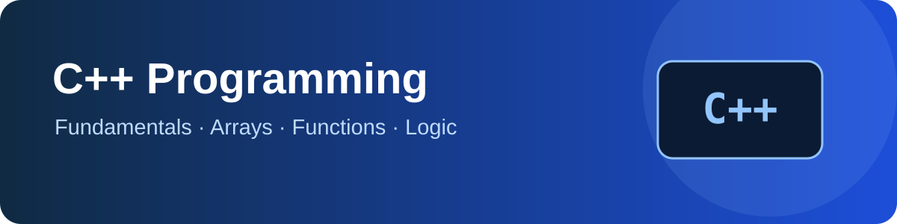

# C++ Programming Foundations

<p align="center"></p>

<p align="center"><strong>Beginner-friendly C++ exercises covering syntax, arrays, loops, functions and problem solving.</strong></p>

## Concepts Used

| Concept | Example files | What it demonstrates |
|---|---|---|
| Standard input/output | `Input_Array.cpp`, `voting.cpp` | Reading values with `cin` and displaying results with `cout` |
| Variables and data types | Beginner examples in the root and `output/` | Storing numbers, characters and calculated values |
| Conditions | `voting.cpp`, `PrimeNumber.cpp` | `if/else` decisions and divisibility checks |
| Loops | `Array.cpp`, `ArraySum.cpp`, `PrimeNumber.cpp` | Repeating work with `for` loops |
| Arrays and traversal | `Array.cpp`, `ArraySum.cpp`, `Input_Array.cpp` | Storing, reading and visiting elements by index |
| Functions and parameters | `Array.cpp`, `array_multiply.cpp`, `PrimeNumber.cpp` | Reusing logic and passing arrays or values to functions |
| Array updates | `array_change.cpp`, `array_multiply.cpp` | Changing array elements |
| Type conversion | `Implicit.cpp`, `Explicit.cpp` | Implicit and explicit conversions |
| Basic validation | `Input_Array.cpp`, `voting.cpp` | Checking input before processing it |

## Selected programs

| File | What it demonstrates |
|---|---|
| `Array.cpp` | Passing an array to a function |
| `ArraySum.cpp` | Summing array elements |
| `array_multiply.cpp` | Generating multiples using an array |
| `PrimeNumber.cpp` | Prime number checking |
| `voting.cpp` | Conditional logic and input validation |
| `Implicit.cpp`, `Explicit.cpp` | Type conversion |
| `Input_Array.cpp` | Reading and processing array input |

Additional beginner exercises are organised in the `Basic program.cpp/` and `output/` folders. These are source-code examples, not compiled output directories.

## Run a program

Requires a C++ compiler such as GCC. From the repository root:

```bash
g++ -std=c++17 -Wall -Wextra -pedantic Array.cpp -o Array
./Array
```

For a nested example, pass its path to the compiler, for example:

```bash
g++ -std=c++17 -Wall -Wextra -pedantic "Basic program.cpp/Add.cpp" -o Add
./Add
```

On Windows, run the generated `.exe` file from the terminal after compilation.

## Repository layout

```text
repo02/
├── .github/workflows/
│   └── cpp-ci.yml
├── assets/
│   └── cpp-learning-banner.svg
├── Basic program.cpp/
│   └── Add.cpp
├── output/
│   └── beginner C++ source examples
├── *.cpp
├── .gitignore
└── README.md
```

Generated executables and IDE build output should stay out of source control. See `.gitignore`.

## Learning roadmap

STL containers, searching, sorting, recursion, linked lists, trees and graphs.

## Maintainer

[Anurag Chaurasiya](https://github.com/anuragchaurasiya)